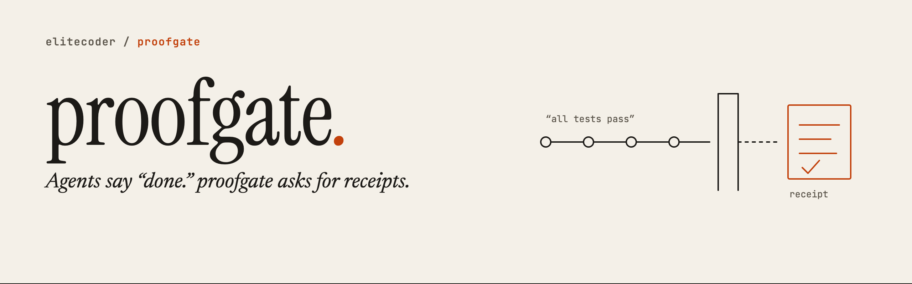
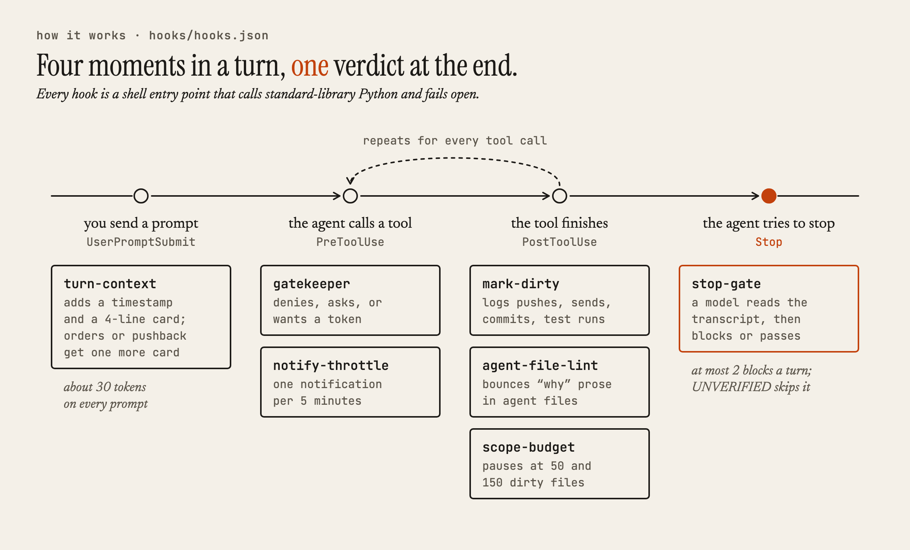
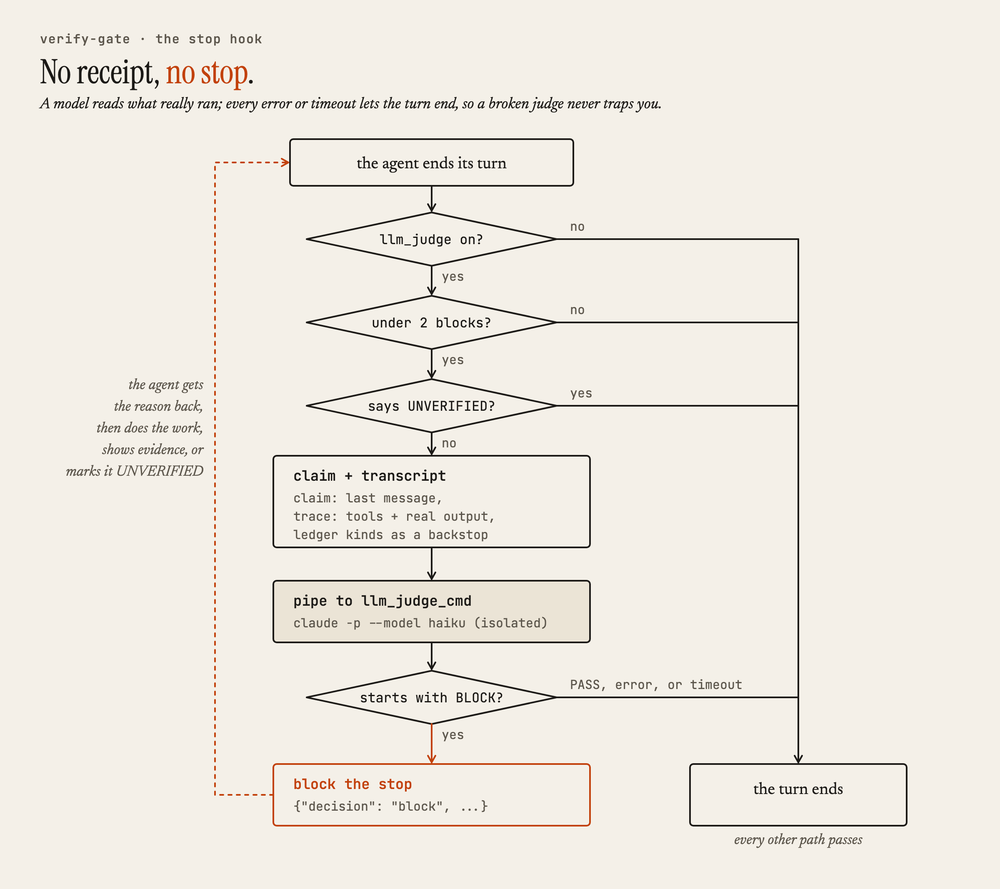
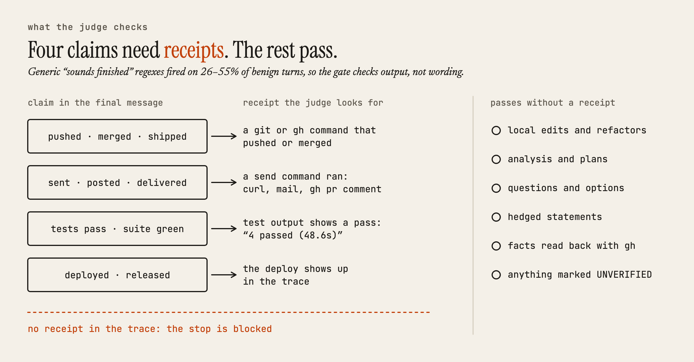
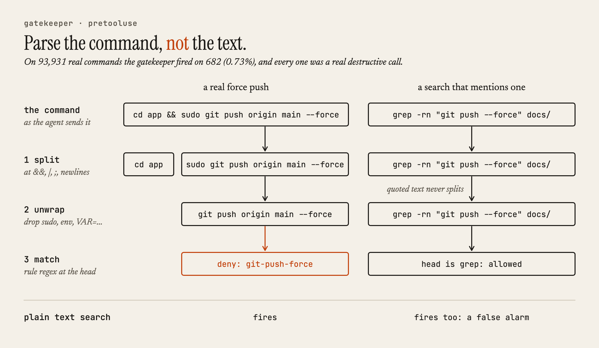
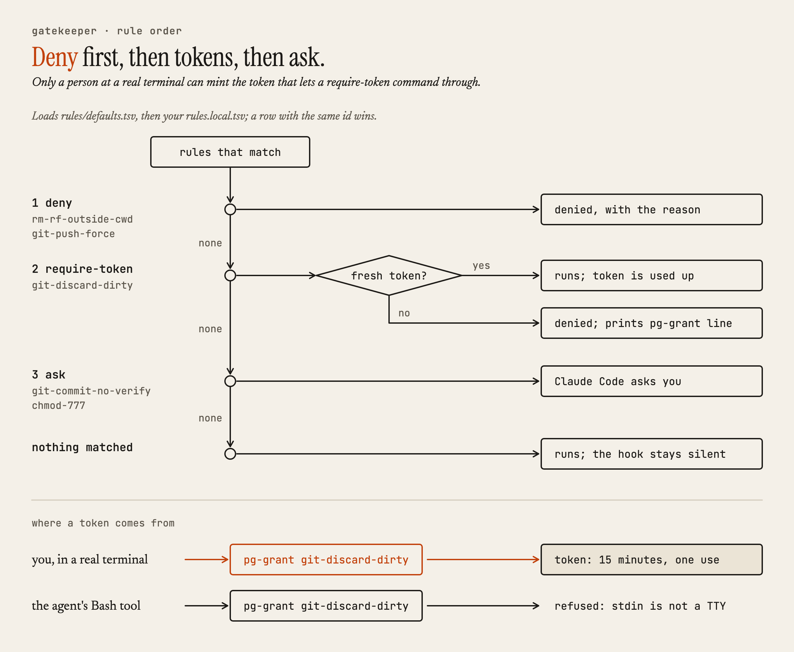
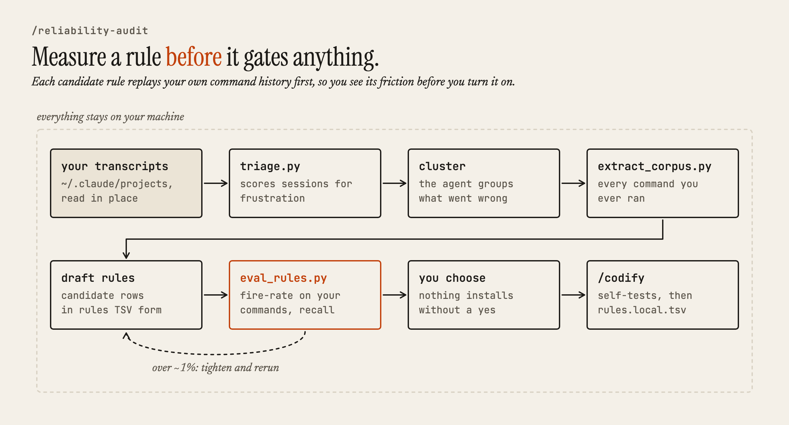
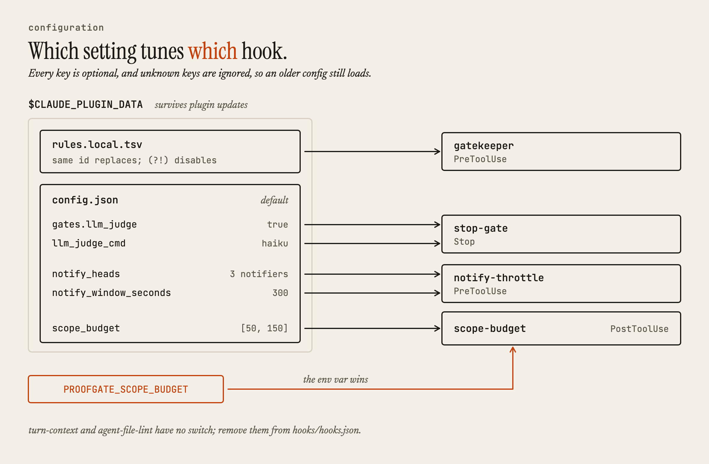

<picture>
  <source media="(prefers-color-scheme: dark)" srcset="docs/images/banner-dark.png">
  
</picture>

**Agents say "done." proofgate asks for receipts.**

Coding agents fail most expensively when they report success that didn't happen:
"All tests pass." "Pushed, PR opened." "Notification sent." proofgate is a
[Claude Code](https://claude.com/claude-code) plugin that checks those claims
against what actually ran before the agent is allowed to stop, and stops destructive
commands before they execute. It grew out of an audit of 5,020 real sessions, and
its command rules were tuned on 93,931 real Bash commands.

## What it looks like

**An unsupported claim.** The agent ends its turn with "Merged the PR," but nothing in
the turn ran `git` or `gh`. The `Stop` hook's judge finds the claim unsupported and answers:

```json
{"decision": "block", "reason": "LLM verify-gate: <one sentence from the judge: which claim is unsupported and what to do>"}
```

The agent has to do the work, show the evidence, or mark the claim `UNVERIFIED`.

**An honest claim.** The same gate lets this turn through, shown the way the judge reads it:

```text
TOOL Bash [ok]: pnpm test:e2e auth.spec.ts
  OUTPUT: Running 4 tests...
  4 passed (48.6s)
TOOL Bash [ok]: git push origin main
  OUTPUT: main -> main
ASSISTANT: All 4 auth specs are green and the fix is pushed.
```

**A destructive command.** In a repo with uncommitted changes, the agent reaches for
`git reset --hard HEAD`. The gatekeeper denies it before it runs:

```text
git reset --hard HEAD permanently discards uncommitted changes in a dirty repo.
Denied: no valid grant token. A human must run
CLAUDE_PLUGIN_DATA=<data-dir> <plugin-root>/bin/pg-grant git-discard-dirty
from a real terminal, then retry within 15 minutes (tokens are single-use).
```

A force push gets a flat no with a better option:

```text
Force push rewrites remote history. Use --force-with-lease instead (it refuses to
overwrite commits you have not seen): git push --force-with-lease <remote> <branch>.
```

The denials are real output from `scripts/gatekeeper/gatekeeper.py`, with local paths
replaced and lines wrapped. The trace comes from `tests/test_verifygate_stopgate.py`.

## Install

From GitHub:

```
/plugin marketplace add elitecoder/proofgate
/plugin install proofgate@proofgate
```

From a local clone, with no network needed:

```
git clone https://github.com/elitecoder/proofgate.git ~/proofgate
/plugin marketplace add ~/proofgate
/plugin install proofgate@proofgate
```

proofgate needs `python3`; its hooks use only the standard library.

### Quick start

The hooks are live as soon as the plugin is installed.

1. **Make sure the judge can answer.** The `Stop` gate pipes its prompt into
   `claude -p --model haiku` by default (with your normal Claude Code sign-in and no
   settings, plugins, or tools), and if that command can't run, every turn passes.
   Confirm you get a reply:

   ```
   echo 'Reply with exactly: PASS' | claude -p --model haiku --setting-sources '' --strict-mcp-config --no-session-persistence --disable-slash-commands --tools ''
   ```

   If it doesn't answer, set `llm_judge_cmd` in `config.json`. The default skips
   your `settings.json`, so a sign-in that comes only from there (an `apiKeyHelper`,
   or provider variables in its `env` block) won't reach the judge. See
   [Configuration](#configuration).

2. **Watch the gatekeeper without waiting for an agent.** From the root of your
   clone, feed it the same JSON Claude Code would. A force push gets a `deny`:

   ```
   echo '{"tool_name":"Bash","tool_input":{"command":"git push --force origin main"}}' \
     | python3 scripts/gatekeeper/gatekeeper.py
   ```

   A command that only mentions a force push prints nothing, meaning it's allowed:

   ```
   echo '{"tool_name":"Bash","tool_input":{"command":"grep -rn \"git push --force\" docs/"}}' \
     | python3 scripts/gatekeeper/gatekeeper.py
   ```

3. **Fix a bug with `/repro-test`.** The agent writes a failing reproduction, then the
   fix, then a `prove` run whose output lands in the transcript the judge reads.

4. **After a week, run `/reliability-audit`** to see what your own sessions say.

## How it works

proofgate is hooks, skills, and local state, with no daemon and no telemetry. The only
thing the hooks send anywhere is the `Stop` gate's prompt, which goes to whatever model
`llm_judge_cmd` runs.

<picture>
  <source media="(prefers-color-scheme: dark)" srcset="docs/images/hook-lifecycle-dark.png">
  
</picture>

A hook at the moment of action doesn't get tired or summarized away by compaction.
Every hook fails open: any internal error exits silently, so a broken proofgate never
wedges a session.

### The stop gate checks output, not wording

<picture>
  <source media="(prefers-color-scheme: dark)" srcset="docs/images/stop-gate-dark.png">
  
</picture>

<picture>
  <source media="(prefers-color-scheme: dark)" srcset="docs/images/claims-dark.png">
  
</picture>

Generic "sounds finished" regexes fired on 26–55% of benign turns in the source corpus,
so the judge reads the real tool output in the transcript and acts only on these four claims.

### The gatekeeper parses commands, not text

<picture>
  <source media="(prefers-color-scheme: dark)" srcset="docs/images/head-parsing-dark.png">
  
</picture>

On the corpus it fired on 0.73% of commands (682 of 93,931), and every hit was a real
destructive invocation.

<picture>
  <source media="(prefers-color-scheme: dark)" srcset="docs/images/gatekeeper-rules-dark.png">
  
</picture>

For events, state layout, and schemas, see [architecture.md](docs/architecture.md).

## Where the numbers come from

proofgate started as a forensic audit of 5,020 real Claude Code sessions from six
weeks of heavy multi-agent use:

- 540 verified failure incidents, clustered into 12 recurring failure modes (the
  [field guide](docs/failure-modes.md) adds a 13th from a later incident)
- command gates tuned against 93,931 real Bash commands
- claim gates tuned against 6,400 assistant-claim → user-reaction pairs
- injectors tuned against 13,107 prompts

The corpus is private session data and doesn't ship. `/reliability-audit` computes the
same statistics from your own local transcripts.

## What's in the box

This table is the full list of what the plugin does to your sessions, including the
parts that run on every prompt.

| Component | Type | What it does |
|---|---|---|
| verify-gate | `Stop` hook | A model reads the transcript and blocks an unsupported push, send, test-pass, or deploy claim. Blocks at most twice per turn; `UNVERIFIED` skips it; fails open. |
| gatekeeper | `PreToolUse` hook | Matches command heads against the shipped rules plus your `rules.local.tsv`, and answers deny, ask, or require-token. |
| pg-grant | CLI | Mints a single-use, 15-minute override token for a `require-token` rule. Refuses to run without a TTY. |
| turn-context | `UserPromptSubmit` hook | Adds a UTC timestamp and a 4-line card to every prompt (about 30 tokens). Direct orders (0.4% of corpus prompts) get an authority card; pushback (0.1%) gets a re-verify card. |
| notify-throttle | `PreToolUse` hook | Denies a second notification command within 5 minutes per session and asks for one rollup. An `ACTION:` payload goes through. |
| scope-budget | `PostToolUse` hook | Blocks once when the repo crosses 50, then 150, dirty files, and asks for a one-line scope inventory. |
| agent-file-lint | `PostToolUse` hook | Bounces rationale prose and lines over 250 characters in `CLAUDE.md`, `AGENTS.md`, `SKILL.md`, and other agent-facing files. |
| `/codify` | skill | Turns your correction into a gatekeeper rule, then self-tests it against a must-catch command and a near-miss. |
| `/defer` | skill | Records "later" as a DEFERRALS.md line with a concrete trigger, plus a GitHub issue when `gh` works. |
| `/repro-test` | skill | Failing reproduction first, then the fix, a green run, and a `prove` receipt. Model-followed, not a hook. |
| prove, prove-cov | CLI | Record a receipt when a command exits 0 with output; `prove-cov` also records which files executed lines. Their output lands in the transcript the judge reads. |
| `/reliability-audit` | skill | Mines your local transcripts, clusters your failure modes, and measures candidate rules against your own commands. |

## Make it yours with /reliability-audit

The shipped gates were tuned on one engineer's six weeks, so your failure modes won't
match exactly. `/reliability-audit` mines your local transcripts and measures each
candidate rule against your own command history before it gates anything.

<picture>
  <source media="(prefers-color-scheme: dark)" srcset="docs/images/reliability-audit-dark.png">
  
</picture>

## Configuration

proofgate reads one optional file, `config.json`, in the plugin's data directory
(`$CLAUDE_PLUGIN_DATA`, which survives plugin updates):

```json
{
  "gates": {
    "llm_judge": true
  },
  "llm_judge_cmd": "claude -p --model haiku --setting-sources '' --strict-mcp-config --no-session-persistence --disable-slash-commands --tools ''",
  "notify_heads": ["notify-send", "terminal-notifier"],
  "notify_window_seconds": 300,
  "scope_budget": [50, 150]
}
```

<picture>
  <source media="(prefers-color-scheme: dark)" srcset="docs/images/configuration-dark.png">
  
</picture>

To turn off the `Stop` gate, set `"llm_judge": false`. To turn off the scope budget,
set `scope_budget` or `PROOFGATE_SCOPE_BUDGET` to `0`. [configuration.md](docs/configuration.md)
covers every key, the shipped rules, and override tokens. To write a rule, see the
[rules.tsv schema](docs/architecture.md#rulestsv-schema).

## Uninstall

```
/plugin uninstall proofgate@proofgate
/plugin marketplace remove proofgate
```

Run both. A marketplace that's still registered can keep the hooks loading even
after the plugin is uninstalled. To keep proofgate registered but off, set
`"enabledPlugins": {"proofgate@proofgate": false}`. For why, and which local
directories to delete for a clean slate, see
[uninstall details](docs/configuration.md#uninstall).

## Is this for you?

The value scales with how hard you push agents.

- **Casual, single-session use:** modest value. You're watching every turn anyway.
- **Long autonomous sessions:** real value. The claims you can't watch are the ones
  that need receipts.
- **Parallel agents and orchestration:** the most value. In a pipeline, one agent's
  unverified "done" becomes another agent's input, and a single phantom completion
  spreads to everything downstream. The source corpus came from this kind of use,
  and proofgate was tuned for it.

## Roadmap

- **Model-in-the-loop evals with baseline-red discipline:** every eval must fail
  without the plugin before it counts as a test of the plugin.
- **Hook-enforced red→green:** the ledger already records failing runs. A future
  gate will require a recorded red before the green for edited tests, instead of
  leaving red-first discipline to `/repro-test`.
- **Block-reason effectiveness matrix:** measure which block phrasings actually
  change agent behavior, per model. A block reason the agent argues with is a bad
  block reason.
- **Community rules:** shared rules-TSV packs, each published with its measured
  fire-rate, so you know the friction cost before you import one.

## Docs

- [The failure modes: an anonymized field guide](docs/failure-modes.md)
- [Configuration and uninstall](docs/configuration.md)
- [Architecture: events, scripts, state, and schemas](docs/architecture.md)
- [Changelog](CHANGELOG.md)

## License

MIT. See [LICENSE](LICENSE).
